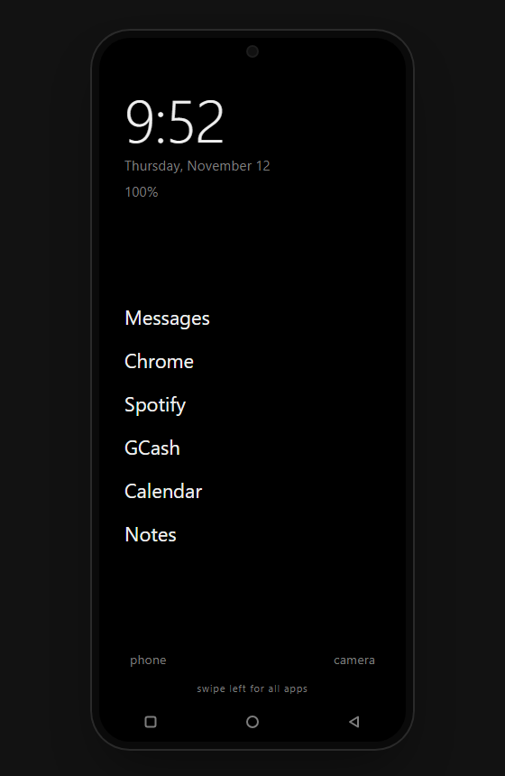

# Minimal

A calm, text-only Android home screen that helps me use my phone less. I built it for my own Redmi 14C, with AI as my coding partner.



## What it does

- **Text-only home screen**: clock, date, battery bar and today's screen time, plus your favorite apps as plain words
- **Full app list**: swipe left, type to search, or jump with the A–Z bar
- **Daily limits and blocks**: set how long an app can be used each day, or block it for a while
- **Mindful pause**: a short wait before distracting apps open
- **Grayscale per app**: chosen apps open in black and white, so they're less tempting
- **Line-art pets**: a chubby cat (or Rocky the Eridian) lives beside the clock and reacts when tapped
- **Make it yours**: rename, hide or reorder apps, switch dark/light, text size, alignment and 12/24h clock

## Try it

- **On a phone**: download the APK from [Releases](../../releases), install it, then pick Minimal as your home app. It needs Android 13 or newer.
- **In a browser**: open `index.html` for a clickable mockup of the home screen.

Grayscale uses Android's own filter, which needs a one-time permission granted from a PC:

```
adb shell pm grant com.angel.minimal android.permission.WRITE_SECURE_SETTINGS
```

## Built with

Kotlin · Android SDK (no extra libraries) · Gradle
